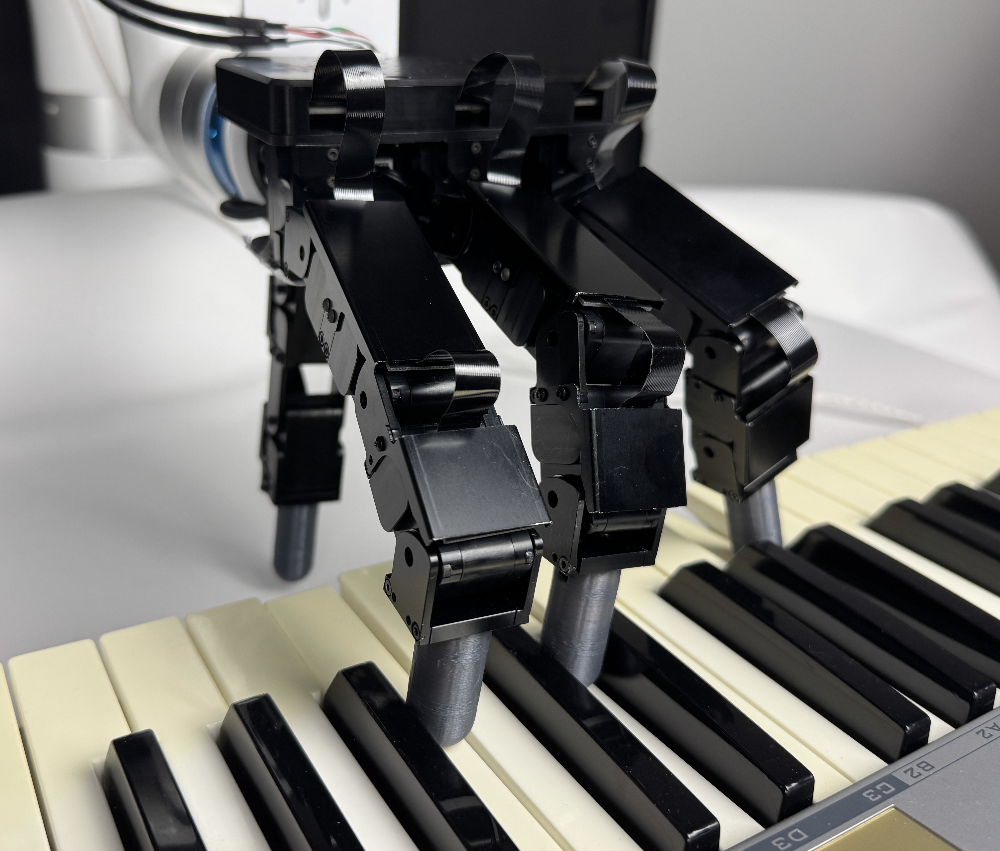

# Learning to Play Piano in the Real World

This project is based on the [Robopianist](https://github.com/google-research/robopianist) environment.
While the Robopianist environment focuses entirely on simulation, this project implements a sim2real2sim transfer.
You can find videos of this project and further details
at [lasr.org](https://www.lasr.org/research/learning-to-play-piano).

## Entry Points

The project contains multiple entry points for different use cases.

| File                                                        | Purpose                                                                                                                                                            |
|-------------------------------------------------------------|--------------------------------------------------------------------------------------------------------------------------------------------------------------------|
| `train.py`                                                  | Starts a single training training.                                                                                                                                 |
| `training_scheduler.py`                                     | Schedules multiple training runs with varying parameters.                                                                                                          |
| `robopianist/execution/policy_executors.py`                 | Executes a policy in an environment. The policy can be based on a model but does not have to be. The environment can be either in simulation or in the real world. |
| `robopianist/execution/execution_scheduler.py`              | Executes multiple model policies in the real world sequentially.                                                                                                   |
| `RobotCalibration` in `robopianist/execution/robot_apis.py` | Can be used to test the robotics and to align the piano.                                                                                                           |
| `robopianist/execution/auto_tuner.py`                       | Adjusts the simulation parameters to match real world observations as closely as possible.                                                                         |
| `optuna_train.py`                                           | Uses Optuna to optimize the divergence of training in simulation.                                                                                                  |

All files use the parameters specified in `configs.py`.

## License

In our work, we use many different libraries and frameworks. The licenses of these libraries can be found in
the `licenses` folder.
Our work is licensed under the MIT License. For more details, see the `LICENSE` file at the root of the repository.